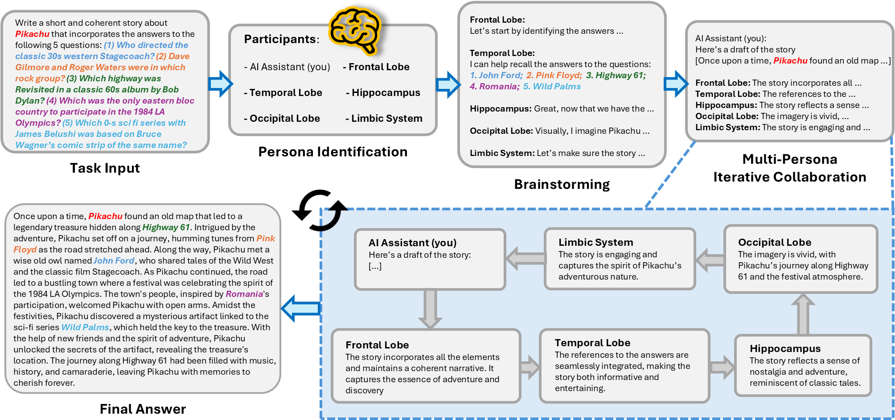

# When LLMs Think Like a Brain: Brain Performance Prompting for Cognitive Synergy

Geon Park, Hongjin Kim, Juoh Sun, Geunyeong Jeong, Harksoo Kim

## Abstract
Human cognitive synergy solves complex problems through interactions among different cognitive processes, and recent studies have explored how to reproduce such synergy within LLMs. A representative example is Solo Performance Prompting (SPP), which improves performance through self-collaboration using profession- or identity-based personas. However, SPP cannot adjust persona configuration or granularity according to each task's cognitive demands and complexity, often applying similar configurations to tasks requiring different cognitive functions. In this work, we propose **Brain Performance Prompting (BPP)**, which dynamically constructs brain-region-based personas according to task-specific cognitive demands. Inspired by selective activation in the human brain, BPP organizes granularity-aware self-collaboration using brain-region personas corresponding to cognitive functions. By adjusting persona configuration and granularity for each task, BPP more appropriately allocates cognitive resources for problem solving. Experimental results show that BPP achieves more stable and superior performance than existing methods, including SPP. We further confirm that activated personas vary across task types and granularity levels while aligning with known neural functions.

## Overview


## Requirements
- Install dependencies
    ```
    pip install -r requirements.txt
    ```
- To run open models (Qwen2.5, Llama-3.1) with `MODEL_TYPE="open_model"`, additionally install [vLLM](https://github.com/vllm-project/vllm).
- Write your API keys in the `config_template.sh` file, then run `source config_template.sh`.
    - `OPENAI_API_KEY`: required for GPT-series models (e.g., GPT-4o, GPT-4o-mini, o1-mini).
    - `ANTHROPIC_API_KEY`: required only when using Claude models (e.g., the LLM-as-a-Judge evaluation in `bpp_llm_neuro_judge.py`).

## Quick Start
You can run BPP for each of the three main tasks using the following commands. If you want to use a different configuration for the model, method, etc., you can modify settings such as `MODELS` and `METHODS` in the `scripts/` folder.
- Trivia Creative Writing: `bash scripts/trivia_creative_writing.sh`
- Codenames Collaborative: `bash scripts/codenames_collaborative.sh`
- Logic Grid Puzzle: `bash scripts/logic_grid_puzzle.sh`

Supported methods include `standard`, `cot`, `self_refine`, `spp`, and `bpp`. Repeated runs can be configured with the `RUNS` and `RUN_START` environment variables (e.g., `RUNS=3 RUN_START=1 bash scripts/trivia_creative_writing.sh`).

## Experimental Setup
The paper evaluates BPP on Trivia Creative Writing (N=5, 10), Codenames Collaborative, and Logic Grid Puzzle, using GPT-4o as the main model and GPT-4o-mini, o1-mini, Qwen2.5-7B-Instruct, Qwen2.5-14B-Instruct, and Llama-3.1-8B-Instruct as additional models. Outputs of each run are written to the `logs/` folder, organized by task and model.

## How to Cite
If you find this code interesting or useful, please consider citing the paper and starring this repo.
```bibtex
@article{park2026bpp,
  title   = {When LLMs Think Like a Brain: Brain Performance Prompting for Cognitive Synergy},
  author  = {Park, Geon and Kim, Hongjin and Sun, Juoh and Jeong, Geunyeong and Kim, Harksoo},
  journal = {Mathematics},
  year    = {2026},
  note    = {Submitted}
}
```

## Acknowledgements
Our code is based on [SPP](https://github.com/mikewangwzhl/solo-performance-prompting?tab=readme-ov-file), and we would like to thank the original authors.
